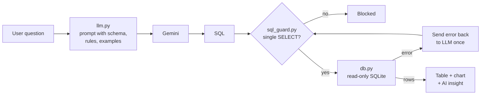

# Ask Your Hospital Data

A Streamlit app where you type a question about hospital data in plain English and get back a table, a chart and a short insight. An LLM (Google Gemini) turns the question into SQL, the app checks the SQL is safe, runs it on a SQLite database and shows the result.

All data is synthetic. No real patient data is used.

## Problem

Hospital managers often have simple questions like "which department has the most readmissions?" but need an analyst to write SQL for them. This project lets them ask directly, while making sure the AI can only read data and never change it.

## How it works



| File | What it does |
| --- | --- |
| `src/generate_data.py` | Creates `data/hospital.db` with 500 patients and 2000 admissions over the last 12 months |
| `src/llm.py` | All Gemini calls: builds the prompt, gets SQL, fixes SQL, writes the insight |
| `src/sql_guard.py` | Rejects anything that isn't a single SELECT and adds a row limit |
| `src/db.py` | Opens the database read-only and runs queries |
| `src/pipeline.py` | Connects the steps above and retries once if the SQL fails |
| `src/charts.py` | Line chart for dates, bar chart for categories |
| `app.py` | Streamlit UI |

Tables: `patients`, `departments`, `doctors`, `admissions`.

## Example questions

- Top 5 diagnoses by count
- Monthly admissions trend
- Average bill by department
- Readmission rate by department
- Which department had the most readmissions last month?

Screenshots: _coming soon_

## Safety measures

- **Only SELECT.** `sql_guard.py` blocks DROP, DELETE, UPDATE, INSERT, ALTER, PRAGMA, ATTACH and others, plus multiple statements and SQL comments.
- **Read-only database.** The connection uses SQLite's `mode=ro`, so even if something got past the guard, the database can't be changed.
- **Row limit.** Every query is wrapped with `LIMIT 200` and the db layer only fetches 200 rows.
- **The prompt tells the model to refuse** questions that ask to change data. "delete all patients" is refused by the model, and blocked by the guard if the model writes a DELETE anyway.
- **No retry for unsafe SQL.** Only queries that fail with a database error get sent back to the LLM.
- **API key in `.env`**, which is in `.gitignore`.

## How to run

You need Python 3.11+ and a free Gemini API key from https://aistudio.google.com/apikey

```bash
py -3.11 -m venv .venv
.venv\Scripts\activate
pip install -r requirements.txt
copy .env.example .env
```

Put your key in `.env`, then:

```bash
python src/generate_data.py
streamlit run app.py
```

Run the tests (no API key needed, the LLM is mocked):

```bash
pytest
```

## Limitations

- The data is fake and small, so the numbers don't mean anything medically.
- The LLM can still write a query that runs but answers the wrong question. Showing the SQL helps users catch this.
- The keyword blocklist is simple. The read-only connection is the real protection.
- The free Gemini tier has low rate limits, and each question uses two calls (SQL + insight). The app uses Flash-Lite by default because the regular Flash model only allows 5 requests a minute.
- No login or per-user permissions, which a real hospital system would need.

## What I learned

- Prompt engineering: giving the model the schema, clear rules and a few example question/SQL pairs (few-shot) made the SQL much more reliable.
- Never trust LLM output directly. It should be checked like user input, which is the same idea as preventing SQL injection.
- Defense in depth: the guard, the read-only connection and the row limit each cover for the others.
- Mocking the LLM in tests so they are fast, free and don't need a key.
- Keeping all LLM calls in one file makes it easy to switch providers later.
